# Computer Graphics Lab

This repository contains implementations of computer graphics algorithms using **Python and PyOpenGL**. Lab 9 uses the **Unity** game engine with C#, and Lab 8 also has an additional Unity version.

## Repository Structure

```text
CGVR/
├── LabN/                      Labs 1-7 and 10: main.py + Output/ (screenshots)
├── Lab8/
│   ├── main.py                OpenGL + GLSL version
│   ├── Output/
│   └── Lab8Unity/             Unity + HLSL version (Assets/, Packages/, ProjectSettings/, Output/)
├── Lab9/                      Unity project (Assets/, Packages/, ProjectSettings/, Output/)
├── 2d-transformations.html    Interactive notes for Labs 3-4 (open in a browser)
├── CG & VR Lab Manual.pdf     Course lab manual
└── requirements.txt           Python packages (PyOpenGL, PyOpenGL_accelerate, glfw)
```

## Lab Programs

### 1. DDA and Bresenham Line Drawing Algorithms

**Description:**
The Digital Differential Analyzer (DDA) algorithm samples the line at unit intervals along its longer axis and rounds the floating-point coordinates to the nearest pixel. The Bresenham Line Drawing Algorithm is an incremental line rasterization algorithm that uses only integer arithmetic to decide which pixels best approximate the line.

The program reads the line endpoints (press Enter to use the default line from `(100, 100)` to `(700, 400)`) and draws the line with DDA in the left panel (green) and with Bresenham in the right panel (red) so the two can be compared.

**Implementation:**

[`Lab1/main.py`](Lab1/main.py)

**Output:**

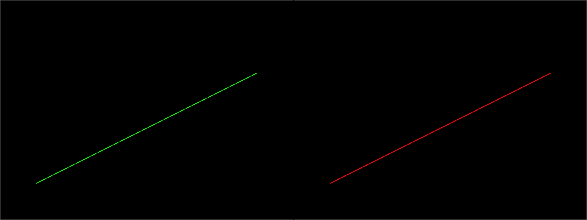

---

### 2. Midpoint Circle Drawing Algorithm

**Description:**
The Midpoint Circle Drawing Algorithm uses a decision parameter to determine the closest pixels to the circumference of a circle. It calculates one octant of the circle and uses 8-way symmetry to generate the remaining points.

The program reads the center and radius (press Enter to use the default center `(400, 300)` and radius `150`).

**Implementation:**

[`Lab2/main.py`](Lab2/main.py)

**Output:**

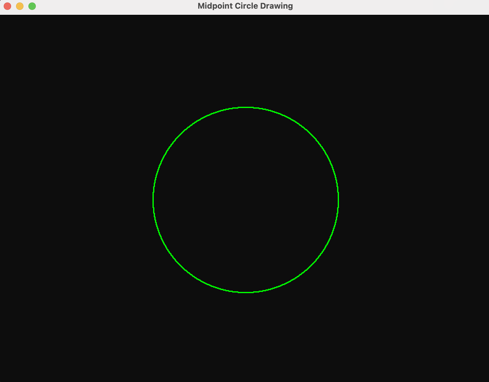

---

### 3. 2D Transformations Using Homogeneous Coordinates

**Description:**
Lab 3 demonstrates 2D geometric transformations using **3x3 homogeneous transformation matrices**. The program supports translation, rotation, scaling, reflection, and shearing. It displays the original shape with a dashed blue outline and the transformed shape with a solid red outline.

The sample shape uses three vertices:

* `(-1, 0)`
* `(1, 0)`
* `(0, 2)`

The number of vertices, vertex coordinates, transformation type, transformation values, rotation pivot, scaling fixed point, reflection axis, and shearing reference point are all customizable through the program prompts.

**Implementation:**

[`Lab3/main.py`](Lab3/main.py)

Interactive notes on the 2D transformation matrices (also covering the composite transformations of Lab 4): [`2d-transformations.html`](2d-transformations.html), open it in a browser.

**Outputs:**

#### Translation

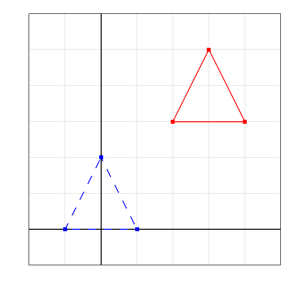

#### Rotation

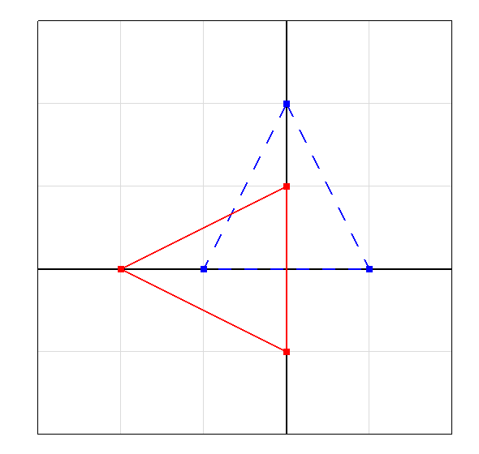

#### Scaling

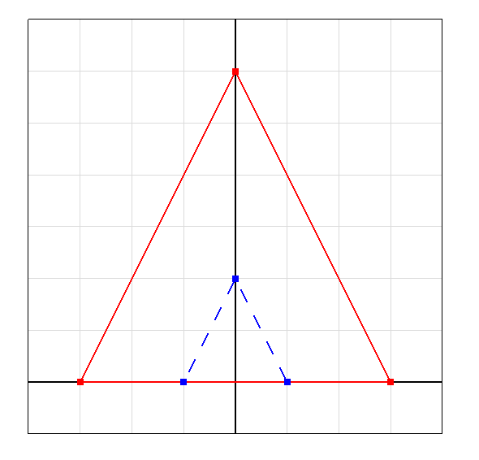

#### Reflection

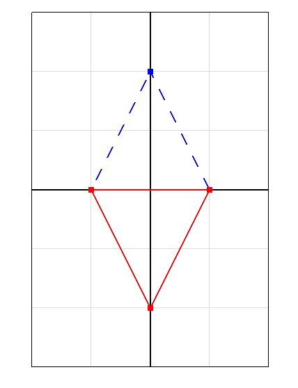

#### Shearing

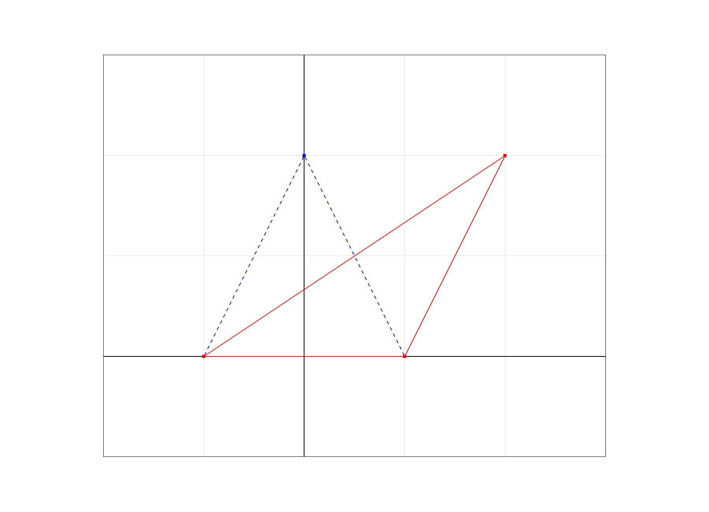

---

### 4. Composite 2D Transformations Using Matrix Representation

**Description:**
Lab 4 extends Lab 3 by chaining multiple 2D transformations (translation, rotation, scaling, reflection, and shearing) into a single **composite transformation matrix**. The program reads a custom shape, lets the user build a sequence of transformations, and applies them one after another, printing the intermediate coordinates at every stage. Each stage of the transformation is animated on the graph so the full sequence from the original shape to the final result can be visualized. Press `R` to replay the animation.

**Implementation:**

[`Lab4/main.py`](Lab4/main.py)

**Output:**

<video src="https://raw.githubusercontent.com/neerajprao/CGVR/main/Lab4/Output/Lab4_Demo.mp4" controls width="600"></video>

> If the video above does not render, watch/download it directly: [`Lab4/Output/Lab4_Demo.mp4`](Lab4/Output/Lab4_Demo.mp4)

---

### 5. Cohen-Sutherland Line Clipping Algorithm

**Description:**
Lab 5 implements the **Cohen-Sutherland Line Clipping Algorithm**, which clips a line segment against a rectangular clipping window. Each endpoint is assigned a 4-bit region code (top, bottom, right, left) relative to the window, and the algorithm iteratively computes intersections with the window boundaries until the line is trivially accepted (fully inside) or trivially rejected (fully outside). The original line is drawn in red and the clipped portion inside the window is highlighted in green.

The clipping window is `x = [-4, 4]`, `y = [-3, 3]`. The program reads the line endpoints (press Enter to use the default line from `(-8, -6)` to `(8, 6)`) and prints the region codes and the clipped line.

**Implementation:**

[`Lab5/main.py`](Lab5/main.py)

**Output:**

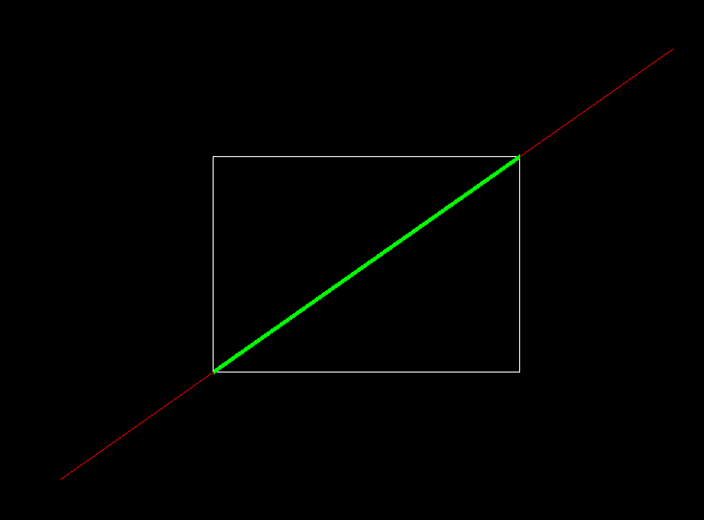

---

### 6. Z-Buffer Algorithm for Hidden Surface Removal

**Description:**
Lab 6 implements the **Z-buffer (depth buffer) algorithm** in software. Every pixel stores a color in the frame buffer and a depth in the depth buffer, initialized to the background color and the farthest depth. Each polygon is scan converted, its depth at every pixel is computed from its plane equation `Ax + By + Cz + D = 0` (incrementally, `z' = z - A/C` along a scan line), and the pixel is overwritten only if the new surface is closer to the viewer. Because the test is done per pixel, it correctly handles polygons that pass through each other.

The default scene has four polygons, including a red band tilted in depth that passes through a green band. The left panel draws the polygons in input order without a Z-buffer (the far blue wall wrongly covers everything), and the right panel shows the correct result with the Z-buffer. Press `D` to switch the right panel to a grayscale view of the depth buffer (nearer = brighter). The program prints each polygon's plane equation, depth-test results, and visible pixel count. Custom polygons can be entered instead of the default scene.

**Implementation:**

[`Lab6/main.py`](Lab6/main.py)

**Outputs:**

#### Without vs With Z-Buffer

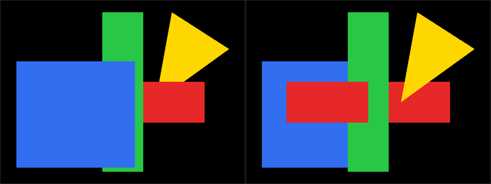

#### Depth Buffer

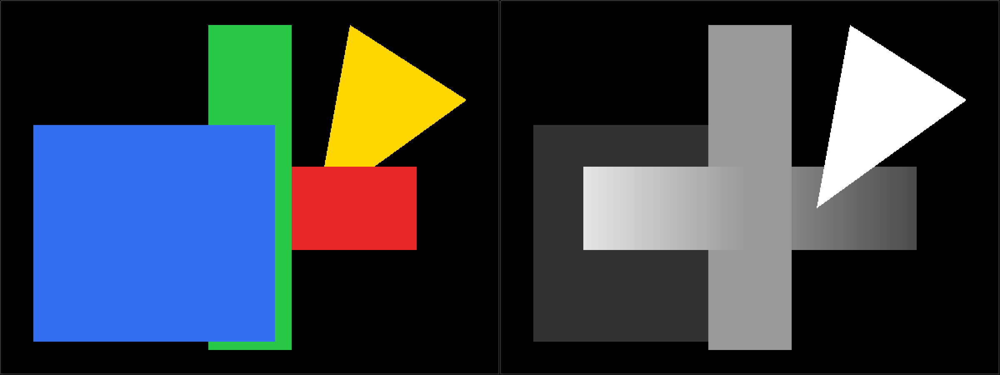

---

### 7. Phong Illumination Model

**Description:**
Lab 7 implements the **Phong illumination model** on a 3D sphere, evaluated in software at every pixel:

```
I = ka·Ia + kd·Il·(N·L) + ks·Il·(R·V)^n
```

where `N` is the surface normal, `L` the unit vector to the point light, `R = 2(N·L)N − L` the reflection of `L`, and `V` the view vector. The window shows the three terms separately and then their sum: **Ambient | Diffuse | Specular | Phong**. Ambient and diffuse light take the object's color, while the specular highlight takes the light's color (white).

The program reads the coefficients `ka`, `kd`, `ks`, the shininess exponent `n`, the light position, and the object color (press Enter to keep the defaults), then prints a worked example of every vector and term at the brightest point on the sphere. In the window, the arrow keys move the light, `+`/`-` double or halve the shininess, and `R` resets.

**Implementation:**

[`Lab7/main.py`](Lab7/main.py)

**Outputs:**

#### Default (shininess n = 32)

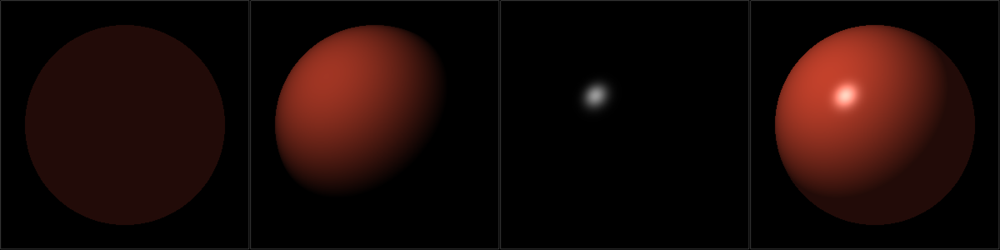

#### Low shininess (n = 4): wider, softer highlight

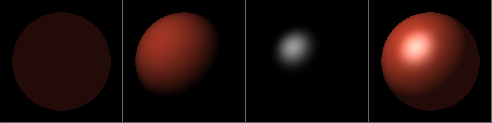

---

### 8. Basic OpenGL Program Using Vertex and Fragment Shaders

**Description:**
Lab 8 uses the **programmable pipeline** (OpenGL 3.3 core profile) to draw a rotating 3D cube with GLSL shaders. The cube's vertices (position, color, and normal for each of 24 vertices) are uploaded once to GPU memory in a **VBO**, the 36 triangle indices in an **EBO**, and the attribute layout is recorded in a **VAO**.

* The **vertex shader** runs once per vertex: it transforms the vertex with the model, view, and projection matrices (passed as uniforms) and passes its color, normal, and world position on to the next stage.
* The **fragment shader** runs once per pixel on the values interpolated across each triangle. It has three modes: interpolated vertex colors, per-fragment Phong lighting (Lab 7's model on the GPU), and the surface normal shown as a color.

The program reads the rotation speed and the starting fragment shader mode (press Enter to keep the defaults), and prints the OpenGL/GLSL versions, the shader compile and link status, and the vertex layout. In the window, `M` switches the fragment shader mode and `Space` pauses the rotation. The GPU's depth buffer is enabled for hidden surface removal (see Lab 6).

**Implementation:**

[`Lab8/main.py`](Lab8/main.py)

**Outputs:**

#### Vertex colors (interpolated)


#### Per-fragment lighting

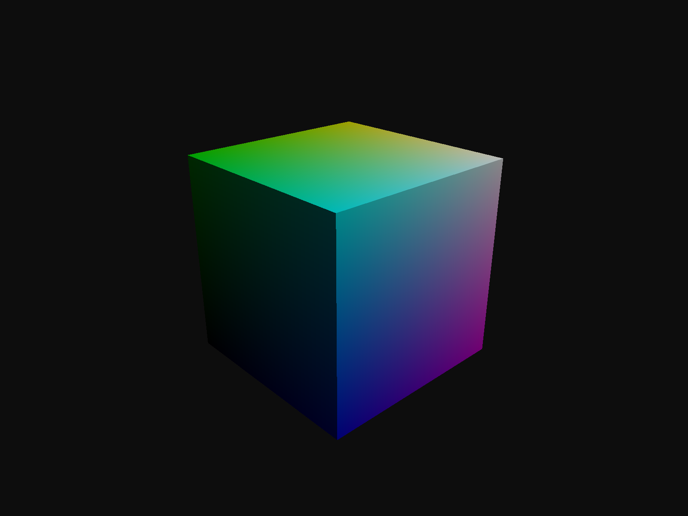

#### Normals as colors

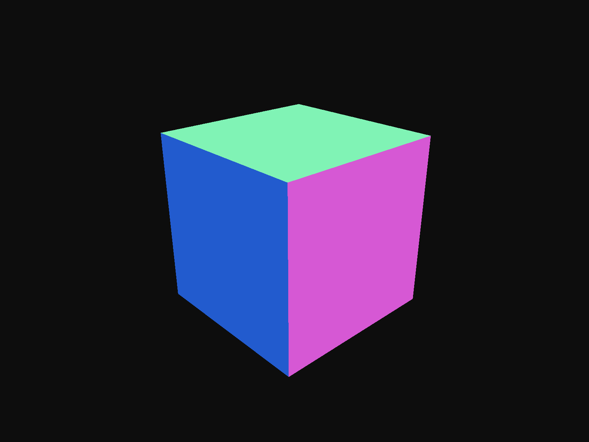

#### Lab 8 in Unity

The same program is also built in **Unity** (Unity 6, Universal Render Pipeline) as an addition to the OpenGL version. The shaders are written by hand in HLSL rather than using a built-in Unity material, and the cube is built in code rather than using Unity's cube primitive:

* **Vertex and fragment shaders** ([`CubeShader.shader`](Lab8/Lab8Unity/Assets/Shaders/CubeShader.shader)): the same vertex shader (model → world → clip, passing color, normal, and world position) and the same three fragment shader modes as the GLSL version, with the same Phong constants. Unity supplies the model, view, and projection matrices as built-in uniforms (`unity_ObjectToWorld`, `UNITY_MATRIX_V`, `UNITY_MATRIX_P`).
* **Vertex data** ([`CubeMesh.cs`](Lab8/Lab8Unity/Assets/Scripts/CubeMesh.cs)): the 24 vertices (position, color, normal) and 36 indices are built in code into a `Mesh`, which plays the role of the VBO, EBO, and VAO.
* **Uniforms and input** ([`ShaderController.cs`](Lab8/Lab8Unity/Assets/Scripts/ShaderController.cs)): spins the cube at 45°/s (tilted 25°), sends `_Mode` and the light position to the shader through a `MaterialPropertyBlock`, and logs the graphics API, shader status, and vertex layout to the Console. `M` switches the fragment shader mode and `Space` pauses the rotation.

Unity is **left-handed** (+Z points into the screen) while OpenGL is right-handed, so the cube, camera `(0, 0, -6)`, and light `(3, 4, -5)` are mirrored in z, the rotation angles are negated, and each triangle's index order is reversed (Unity's front faces are clockwise). With these changes the picture matches the OpenGL version. The shader also converts its output to linear color space so the colors match.

**Outputs (Unity):**

| Vertex colors | Per-fragment lighting | Normals as colors |
|---|---|---|
| 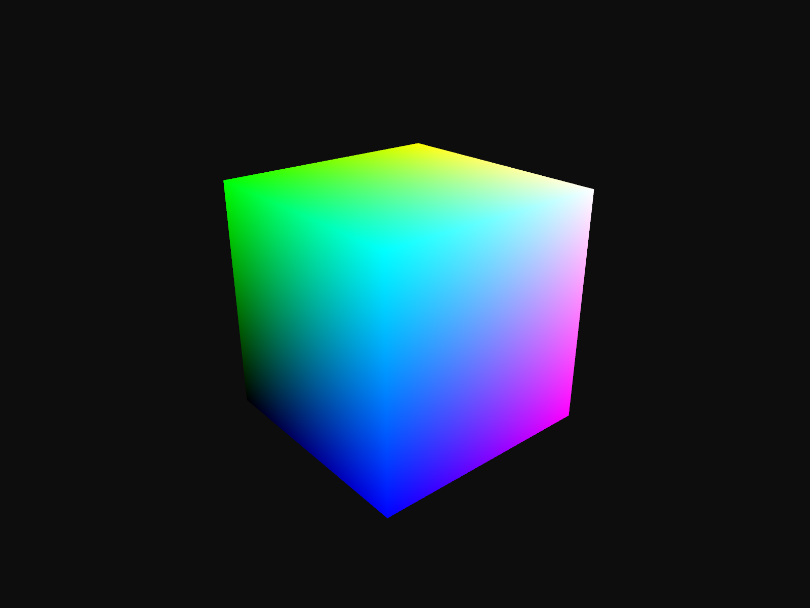 | 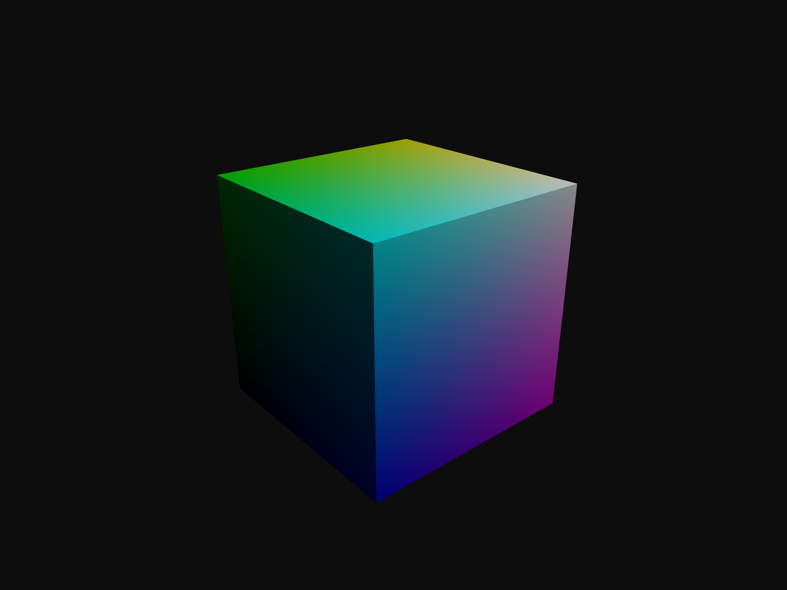 | 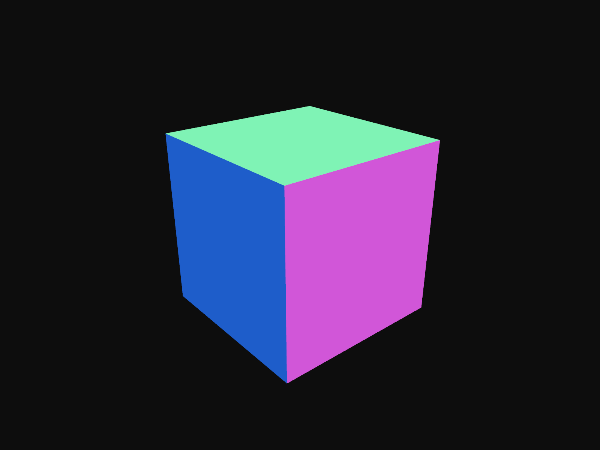 |

---

### 9. Simple Interactive 3D Scene Using Unity

**Description:**
Lab 9 builds a small interactive 3D scene in the **Unity** game engine (Unity 6, Universal Render Pipeline) with C# scripts. Every object in the scene is a **GameObject** with a **Transform** (position, rotation, scale), and its behaviour comes from the components attached to it: a mesh renderer and **material** for its appearance, a **collider** for hit testing, and scripts for interaction.

* **Ground:** a plane scaled ×3 into a 30 × 30 floor with a green material.
* **Player:** a blue cube that moves with `W`/`A`/`S`/`D` or the arrow keys at 5 units per second, turns to face its direction of motion, and is clamped so it stays on the ground.
* **Spinners:** a sphere, a cylinder, and a cube, each rotating continuously about its own axis (Y at 90°/s, the diagonal (1, 1, 0) at 120°/s, and X at 60°/s).
* **Mouse picking:** a left click casts a **ray** from the camera through the mouse position (`Camera.ScreenPointToRay` + `Physics.Raycast`). If the ray hits a spinner, the spinner pauses or resumes and changes to a random color, and the click is logged in the Console.
* **Camera:** follows the player from a fixed offset `(0, 6, -10)`, smoothed with `Vector3.SmoothDamp`, and keeps looking at it.

Movement is multiplied by `Time.deltaTime`, so speeds are in units (or degrees) per second, independent of the frame rate. Input is read through Unity's new **Input System** (`Keyboard.current`, `Mouse.current`). A directional light casts shadows on the ground.

**Implementation:**

* [`Lab9/Assets/Scripts/PlayerController.cs`](Lab9/Assets/Scripts/PlayerController.cs): keyboard movement and turning
* [`Lab9/Assets/Scripts/Spinner.cs`](Lab9/Assets/Scripts/Spinner.cs): continuous rotation, pause and recolor on click
* [`Lab9/Assets/Scripts/ClickInteractor.cs`](Lab9/Assets/Scripts/ClickInteractor.cs): mouse picking with a raycast
* [`Lab9/Assets/Scripts/CameraFollow.cs`](Lab9/Assets/Scripts/CameraFollow.cs): smooth follow camera
* [`Lab9/Assets/Scenes/SampleScene.unity`](Lab9/Assets/Scenes/SampleScene.unity): the scene

**Output:**

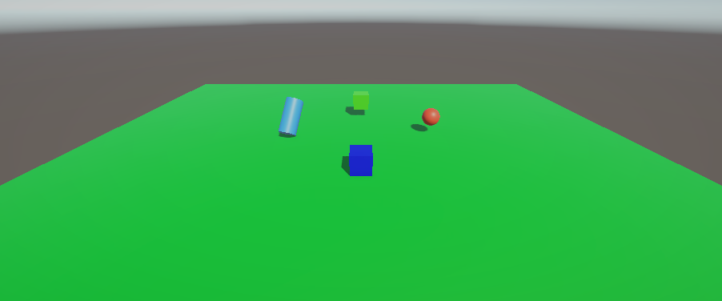

---

### 10. 3D Viewing Pipeline with Projection and Viewport Mapping

**Description:**
Lab 10 implements the **3D viewing pipeline** that turns a 3D object into pixels on a 2D screen. A colored cube passes through every stage:

1. **Model transformation** (object → world): the cube is rotated about the X and Y axes.
2. **View transformation** (world → eye): a **look-at** camera builds its own axes from the eye position, target point, and up vector, so that the camera sits at the origin looking down -Z.
3. **Projection** (eye → clip): the window is split into two viewports. The left one uses a **perspective** projection (field of view 45°), where distant points shrink. The right one uses an **orthographic** (parallel) projection, where parallel edges stay parallel.
4. **Perspective division** (clip → NDC): x, y, and z are divided by w, giving normalized device coordinates in [-1, 1].
5. **Viewport mapping** (NDC → window): NDC are scaled and shifted into each viewport's pixel rectangle, and depth is mapped to [0, 1].
6. **Depth testing**: the GPU's depth buffer removes hidden surfaces (see Lab 6).

The GPU performs stages 4 to 6 automatically. To show them, the program repeats the whole pipeline on the CPU and prints the result: one vertex is traced through every stage, followed by the NDC and window coordinates of all 8 cube corners for each viewport. These values match what the GPU draws.

The program reads the camera position and the rotation speed (press Enter to use the default camera `(3, 2, 6)` and `45` degrees per second). In the window, the `Left`/`Right` keys orbit the camera, `Space` pauses the rotation, `T` prints the pipeline for the current frame, and `Esc` quits. Window coordinates are in framebuffer pixels, which are twice the window size on Retina displays.

**Implementation:**

[`Lab10/main.py`](Lab10/main.py)

**Outputs:**

#### Perspective (left) and orthographic (right) viewports

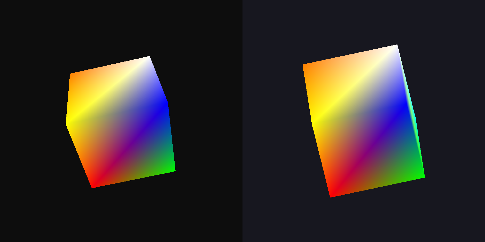

#### Camera orbited 70° to the left

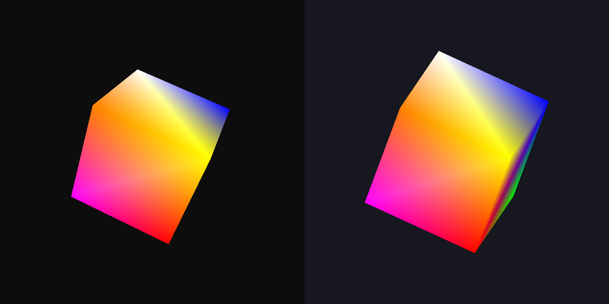

#### Pipeline trace printed in the terminal (perspective viewport)

```text
Vertex 0 through the pipeline:
  1. Object                (  -1.00,   -1.00,    1.00,    1.00)
  2. World  = Model * obj  (  -1.00,   -1.33,    0.48,    1.00)
  3. Eye    = View * world (  -1.11,   -1.27,   -7.39,    1.00)
  4. Clip   = Proj * eye   (  -2.68,   -3.06,    7.21,    7.39)
  5. NDC    = clip / w     (  -0.36,   -0.41,    0.97)
  6. Window = viewport     ( 318.66,  292.76,    0.99)
```

---

## Technologies Used

* Python
* PyOpenGL
* GLFW
* OpenGL
* Unity 6 (Universal Render Pipeline), C#, and HLSL (Lab 9, and the Unity version of Lab 8)


## How to Run

Install the required packages:

```bash
pip install -r requirements.txt
```

Then navigate to the required lab folder and run:

```bash
cd Lab1
python main.py
```

**Lab 9 (Unity):** in Unity Hub, click **Add → Add project from disk** and select the `Lab9` folder, open it with Unity 6, open `Assets/Scenes/SampleScene`, and press **Play**. Unity regenerates the `Library` folder on the first open.

**Lab 8 (Unity version):** the same steps with the `Lab8/Lab8Unity` folder. Click inside the Game view before pressing `M` or `Space`.

Both Unity projects were made with **Unity 6000.6.6f1**. Their `Packages/manifest.json` includes the [MCP for Unity](https://github.com/CoplayDev/unity-mcp) editor package, which Unity downloads from GitHub on the first open. It is only used to automate the editor, so it can be removed if you don't need it. Generated folders (`Library`, `Temp`, `Logs`, `UserSettings`) are not committed.
